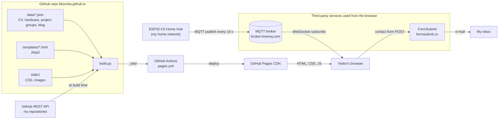
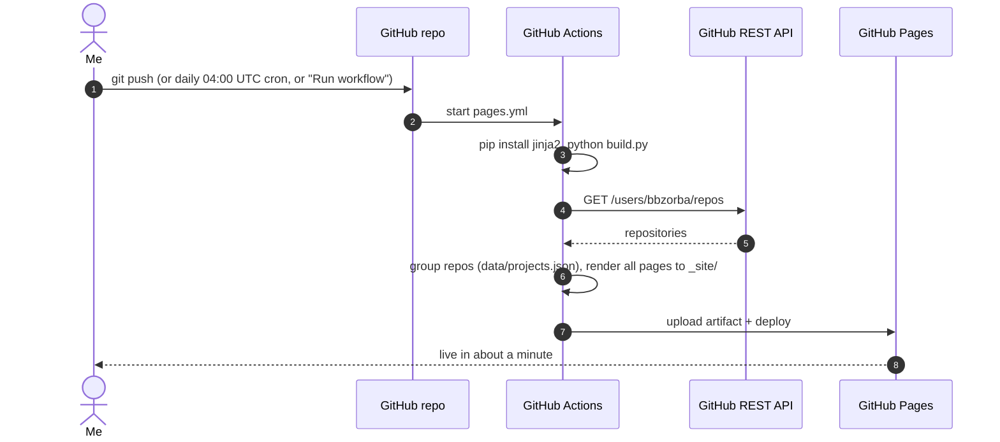
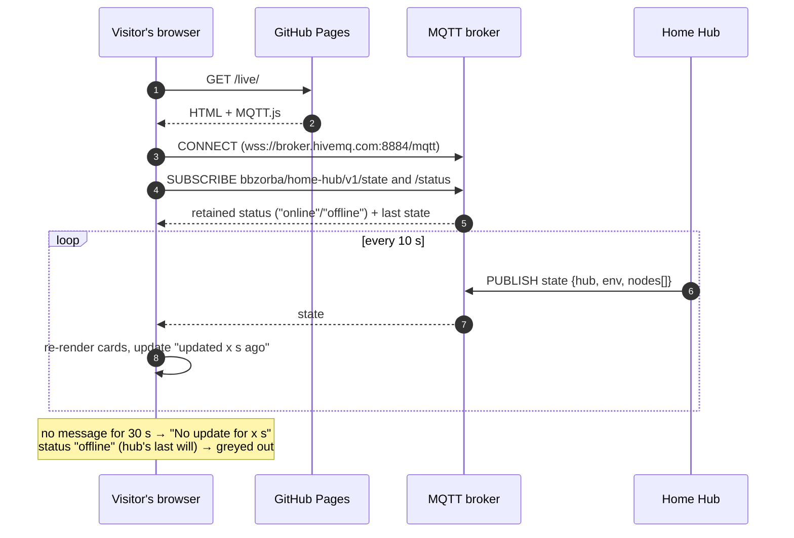
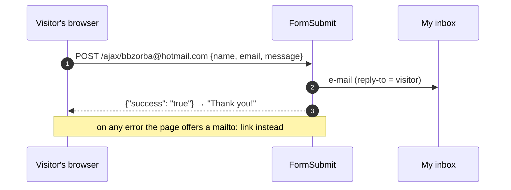

# Website architecture

How [bbzorba.github.io](https://bbzorba.github.io) is built, deployed and
fed with live data. Editing and preview instructions are in
[README.md](README.md).

## The big picture

The site is fully static: GitHub Pages serves plain HTML, CSS and
JavaScript, and there is no server of my own. Everything dynamic happens
either at **build time** (Python + Jinja2 in GitHub Actions) or in the
**visitor's browser** (live sensor data over MQTT, the contact form).

| Page | URL | Content source |
|---|---|---|
| Home | `/` | `templates/home.html` |
| Resume | `/resume` | `data/cv_data.json` |
| Projects | `/my_projects` | `data/projects.json` (groups, titles) + GitHub API (links, languages, dates) |
| Hardware | `/hardware` | `data/hardware.json` |
| Drones | `/drones` | `templates/drones.html` |
| Live Lab | `/live` | MQTT, in the browser |
| Travel | `/travel_blog` | `data/blog_posts.json` |
| Contact | `/contact` | FormSubmit, in the browser |
| Sports | `/sports/...` | templates |

## Build and deploy

The daily run picks up new repositories. Any repository not listed in
`data/projects.json` appears under "Other projects" until it gets a group.
Asset URLs carry a build id (`style.css?v=...`) so browsers fetch fresh CSS
after each deploy.

## Live Lab: publish/subscribe

The page subscribes to the hub's MQTT topics straight from the browser
(MQTT.js over secure WebSocket). Both topics are retained, so a visitor
sees the latest values immediately instead of waiting for the next
10-second publish.

The page renders `nodes[]` generically, one card per node with whatever
sensors it reports. A new node added on the hub side (see the hub's
[ARCHITECTURE.md](https://github.com/bbzorba/ESP32C6-Zephyr-IoT-Projects/blob/main/applications/web_app/ARCHITECTURE.md))
therefore shows up here without any website change.

The topic prefix `bbzorba/home-hub/v1` must match `CONFIG_APP_MQTT_TOPIC_PREFIX`
in the hub firmware.

## Contact form

FormSubmit needs a one-time activation: the very first message sends a
confirmation e-mail to the inbox, and messages are delivered after the
link in it is clicked. A hidden `_honey` field filters simple spam bots.

## Adding content

- **A page:** create `templates/<name>.html` extending `base.html`, add a
  `render(...)` line in `build.py`, and a link in the `links` list in
  `templates/base.html`.
- **A board on the Hardware page:** add an entry to `data/hardware.json`.
- **A project group or title:** edit `data/projects.json`.
- **CV changes:** edit `data/cv_data.json`.
